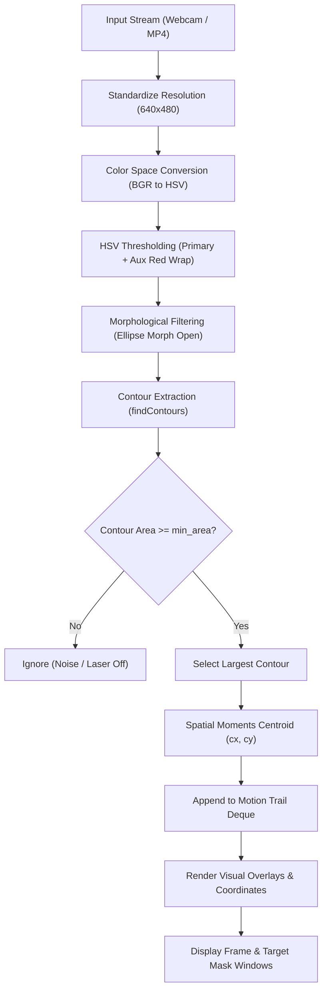

# 🎯 Real-Time Laser Pointer Tracker

[](https://www.python.org/)
[](https://opencv.org/)
[](https://opensource.org/licenses/MIT)

A robust, real-time computer vision system built with **Python**, **OpenCV**, and **NumPy** to detect, calibrate, and track laser pointer dots across live webcams and recorded video streams.

---

## 📋 Table of Contents

- [Overview](#-overview)
- [Key Features](#-key-features)
- [Pipeline Architecture](#-pipeline-architecture)
- [Project Structure](#-project-structure)
- [Installation](#-installation)
- [Quick Start](#-quick-start)
- [CLI Reference](#-cli-reference)
- [Calibration Guide](#-calibration-guide)
- [Mathematical Background](#-mathematical-background)
- [Roadmap & Future Work](#-roadmap--future-work)
- [License](#-license)

---

## 🌟 Overview

Laser pointer tracking is a fundamental computer vision capability with applications across:
* **Interactive Presentations**: Virtual laser pointer stabilization and slide control.
* **Air-Writing & Whiteboards**: Converting hand-held laser strokes into digital sketches.
* **Robotics & Targeting**: Providing visual guidance and target tracking for autonomous systems.

This repository provides both an extensible modular engine (`laser_tracker.py`), an interactive calibration HUD (`color_picker.py`), and backward-compatible assignment scripts (`Assignment 1.py`).

---

## ✨ Key Features

- **Dual-Band HSV Thresholding**: Seamlessly handles color wrap-around for red hues ($0\text{--}10$ and $170\text{--}180$) while supporting green and blue lasers.
- **Subpixel Centroid Precision**: Calculates laser centroid coordinates using image spatial moments ($M_{10}/M_{00}, M_{01}/M_{00}$) instead of coarse bounding-box approximation.
- **Morphological Noise Rejection**: Eliminates sensor noise, reflections, and stray pixels via elliptical structuring elements (`MORPH_OPEN`) and minimum contour area thresholds.
- **Dynamic Trajectory Trail**: Visualizes motion paths with decaying motion history buffers (`collections.deque`).
- **Interactive Calibration HUD**: Pause/resume live streams with the spacebar and click directly on the laser spot to calculate calibrated upper and lower HSV bounds in real-time.
- **Flexible Input Sources**: Accepts live webcam feeds (`0`, `1`), network RTSP streams, or local video files (with automatic FPS pacing).

---

## 🏗 Pipeline Architecture



---

## 📂 Project Structure

```
Laser-assignment/
├── .gitignore               # Ignored files (caches, virtual envs, OS artifacts)
├── Assignment 1.py          # Original assignment entrypoint (cleaned & robust)
├── color picker.py          # Original color picker entrypoint (cleaned & robust)
├── laser_tracker.py         # Modular, feature-rich tracking engine with CLI
├── color_picker.py          # Interactive calibration tool with on-screen HUD
├── Laser assignment.mp4     # Pre-recorded test video demonstration
├── Note.txt                 # Quick reference notes
├── requirements.txt         # Project dependencies
├── ROADMAP.md               # Engineering roadmap for future extensions
└── README.md                # Project documentation
```

---

## 🚀 Installation

### 1. Clone the repository
```bash
git clone https://github.com/jonkolp/Laser-Track.git
cd Laser-Track
```

### 2. Set up a virtual environment (recommended)
```bash
# Using venv
python -m venv .venv

# Activate on Windows (PowerShell)
.venv\Scripts\Activate.ps1

# Activate on Linux / macOS
source .venv/bin/activate
```

### 3. Install dependencies
```bash
pip install -r requirements.txt
```

---

## ⚡ Quick Start

### 1. Run the Main Tracker on a Live Camera
```bash
python laser_tracker.py
```

### 2. Run on the Sample Video
```bash
python laser_tracker.py --source "Laser assignment.mp4"
```

### 3. Save the Tracked Output Video
```bash
python laser_tracker.py --source "Laser assignment.mp4" --output "output_tracked.mp4"
```

### 4. Run Legacy Assignment Scripts
```bash
python "Assignment 1.py"
python "color picker.py"
```

---

## ⚙️ CLI Reference

The primary tracking engine (`laser_tracker.py`) supports full command-line configuration:

```bash
usage: laser_tracker.py [-h] [-s SOURCE] [--width WIDTH] [--height HEIGHT]
                        [--min-area MIN_AREA] [--trail TRAIL]
                        [--lower-hsv H S V] [--upper-hsv H S V]
                        [--no-red-wrap] [-o OUTPUT]
```

| Argument | Flag | Default | Description |
| :--- | :--- | :--- | :--- |
| `--source` | `-s` | `0` | Camera device index (e.g. `0`) or video path (e.g. `"Laser assignment.mp4"`). |
| `--min-area` | `-a` | `5.0` | Minimum contour pixel area required to confirm a laser detection. |
| `--trail` | `-t` | `32` | Number of previous centroid positions to connect as a motion trail (`0` to disable). |
| `--lower-hsv` | | `160 100 100` | Primary lower bound for HSV color thresholding. |
| `--upper-hsv` | | `180 255 255` | Primary upper bound for HSV color thresholding. |
| `--no-red-wrap` | | `False` | Disables the auxiliary lower-red mask ($0\text{--}10$). |
| `--output` | `-o` | `None` | Path to save the processed output video (`.mp4`). |

---

## 🎨 Calibration Guide

Different camera sensors and lighting environments register laser spots differently. Use `color_picker.py` to calibrate your setup:

```bash
python color_picker.py --source "Laser assignment.mp4"
```

### Controls:
- **Left Click**: Sample the pixel under the cursor. The tool automatically computes safe upper and lower bounds with recommended tolerances.
- **Spacebar**: Pause or resume playback so you can accurately click fast-moving laser dots.
- **`c`**: Clear the current on-screen selection card.
- **`q` or `ESC`**: Quit the calibration tool.

---

## 📐 Mathematical Background

### Spatial Moments for Centroid Computation
Instead of taking the center of a simple bounding rectangle ($\frac{x + w}{2}, \frac{y + h}{2}$), which can be distorted by asymmetric glare or reflections, the centroid is derived from image moments:

$$M_{pq} = \sum_{x}\sum_{y} x^p y^q I(x, y)$$

Where $I(x, y)$ is the binary contour intensity. The centroid $(\bar{x}, \bar{y})$ is computed as:

$$\bar{x} = \frac{M_{10}}{M_{00}}, \quad \bar{y} = \frac{M_{01}}{M_{00}}$$

### Hue Wrap-Around
OpenCV maps Hue values from $0^{\circ}\text{--}360^{\circ}$ to $[0, 179]$ by dividing by $2$. Because pure red is centered at $0^{\circ}$ ($0$), intense red lasers split across $[0, 10]$ and $[170, 179]$. Combining both regions avoids losing tracking when the hue shifts slightly:

$$\text{Mask}_{\text{final}} = \text{inRange}(\text{HSV}, \text{Low}_1, \text{High}_1) \lor \text{inRange}(\text{HSV}, \text{Low}_2, \text{High}_2)$$

---

## 🗺 Roadmap & Future Work

Detailed architecture specifications and future milestones are documented in [ROADMAP.md](file:///c:/Users/LOQ/Desktop/Laser%20assignment/ROADMAP.md). Planned features include:

- [ ] **Kalman Filter State Estimation**: Predict laser motion and handle momentary occlusions.
- [ ] **Virtual Air-Canvas (Whiteboard Mode)**: Continuous line drawing with laser on/off click gesture detection.
- [ ] **Multi-Color Support**: Simultaneous tracking of red, green, and blue laser pointers.
- [ ] **Ambient Light Auto-Compensation**: Dynamic background subtraction via MOG2 or adaptive thresholding.

---

## 📄 License

This project is licensed under the [MIT License](https://opensource.org/licenses/MIT).
