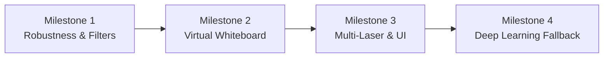

# 🗺 Future Work & Engineering Roadmap

This document outlines architectural plans, future enhancements, and research avenues for extending the **Laser Pointer Tracker** project.

---

## 🎯 Strategic Milestones

---

## 1. Milestone 1: Robust Tracking & State Estimation

### 1.1 Kalman Filter Integration
* **Problem**: When a laser moves rapidly across a surface or is momentarily occluded by an object, standard contour detection drops the track.
* **Solution**: Implement a 2D constant-velocity Kalman Filter (`cv2.KalmanFilter(4, 2, 0)`):
  * **State Vector**: $\mathbf{x} = [x, y, v_x, v_y]^T$
  * **Measurement Vector**: $\mathbf{z} = [z_x, z_y]^T$
  * Enables smooth trajectory prediction during dropped frames and noise rejection for sudden transient flashes.

### 1.2 Dynamic Background Subtraction & Light Adaptation
* **Problem**: Direct sunlight, incandescent bulbs, or shiny metallic surfaces can cause false positives.
* **Solution**:
  * Apply `cv2.createBackgroundSubtractorMOG2(history=500, varThreshold=16, detectShadows=False)` or running average frame differencing.
  * Only track high-frequency luminous points that appear on the foreground mask.

---

## 2. Milestone 2: Interactive Virtual Whiteboard & Gestures

### 2.1 Virtual Drawing Canvas
* Accumulate tracked coordinates onto a persistent canvas (`canvas = np.zeros_like(frame)`).
* Implement stroke smoothing using Catmull-Rom or B-spline interpolation.
* Add color palettes and clear-screen triggers.

### 2.2 Laser "Click" & "Lift" State Machine
* **Laser-Off (Pen-Up)**: When the laser is deactivated for $> N$ frames, finish the current stroke.
* **Laser-Dwell (Click)**: If the centroid remains within a small radius ($r \le 5\text{px}$) for $\ge 1.0\text{s}$, trigger a mouse click or select event.
* **Laser-On (Draw)**: Normal tracking connects line segments.

---

## 3. Milestone 3: Multi-Laser & Multi-Color Tracking

* Support concurrent tracking of:
  * 🔴 **Red Lasers**: $H \in [0, 10] \cup [170, 180]$
  * 🟢 **Green Lasers**: $H \in [35, 85], S \in [100, 255], V \in [150, 255]$
  * 🔵 **Blue/Violet Lasers**: $H \in [100, 130], S \in [100, 255], V \in [150, 255]$
* Assign each color an independent ID, motion trail, and unique overlay color.

---

## 4. Milestone 4: Web Application & Cloud Deployment

* **Streamlit / Gradio UI**:
  * Web-based slider controls for HSV bounds with real-time feedback.
  * Drag-and-drop video upload and preview.
* **WebRTC Integration**:
  * Low-latency browser-based webcam streaming for remote presentations.

---

## 5. Architectural Checklist for Contributors

When submitting PRs or extending the codebase:
1. **Type Annotations**: Ensure all functions use typing (`Optional`, `Tuple`, `np.ndarray`).
2. **PEP 8 Compliance**: Run `flake8` or `ruff` to verify formatting.
3. **No Hardcoded Values**: All thresholds, resolutions, and video paths must be configurable through CLI flags or configuration dictionaries.
4. **Documentation**: Update [README.md](file:///c:/Users/LOQ/Desktop/Laser%20assignment/README.md) and inline docstrings when adding new options.
